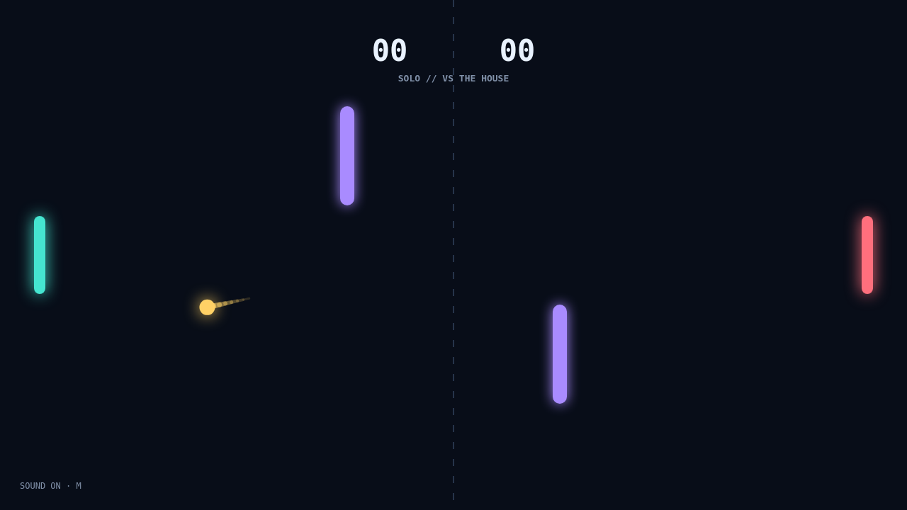

Carom is a fast, local paddle duel played across a midnight field. Start a solo rally against the house or share the keyboard for a head-to-head match, and race to eleven with a two-point lead.

Each paddle return sets the next angle. Meet the ball near a paddle's edge to send it sharply upward or down, then move through contact to add spin. A well-timed stroke makes the ball curve late, turning a safe return into a shot your opponent has to read on the fly.

Two violet bars cut across the middle lanes. They send clean bank shots back into open space and reward players who plan a bounce ahead. Speed rises with every paddle hit, so the opening rally gives way to tighter reactions and match-point pressure.

